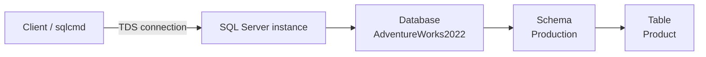

# Lesson 01 — Setup & First Queries

**Prerequisites:** none — this is the first lesson.

You've just connected to a running SQL Server and have no idea what's in it: which
databases exist, what a table looks like, whether a query even returns rows in a
sensible order. This lesson is that muscle memory — every later lesson assumes it.

## What you'll learn

- Connect to the container and run a query end to end
- `SELECT`'s *logical* order of execution: `FROM → WHERE → SELECT → ORDER BY` — not
  the order you type it
- `TOP`, `WHERE`, `ORDER BY`, and why `TOP` needs `ORDER BY` to mean anything
- Two ways to inspect a table's structure: `sp_help` and `INFORMATION_SCHEMA.COLUMNS`

## The mental model

A query lands on one specific table, reached through a chain of context:



`USE AdventureWorks2022;` fixes the database; `Production.Product` in `FROM` names
schema and table together. Skip either and SQL Server guesses wrong (default schema
`dbo`) or says the object doesn't exist.

## Setup

Run `setup.sql` once. It creates the `lesson01` schema (no extra data needed —
AdventureWorks is sufficient for this lesson).

```powershell
# Container must already be running (see root README)
.\scripts\connect.ps1
# Then in sqlcmd:
:r lessons\01-setup-and-basics\setup.sql
```

Or open `setup.sql` in SSMS and press F5.

## Concepts

### 1. `SELECT` anatomy and the logical order of execution

You type `SELECT` first, `WHERE`/`ORDER BY` after — but SQL Server evaluates `FROM`
first, applies `WHERE`, *then* the `SELECT` list, and sorts with `ORDER BY` last. `TOP`
applies after that sort, so `TOP` without `ORDER BY` has nothing meaningful to limit:

```sql
SELECT TOP (5) Name, ListPrice
FROM Production.Product
WHERE ListPrice > 1000
ORDER BY ListPrice DESC;
```

```
Name                     ListPrice
------------------------ -----------
Road-150 Red, 62          3578.2700
Road-150 Red, 44          3578.2700
Road-150 Red, 48          3578.2700
Road-150 Red, 52          3578.2700
Road-150 Red, 56          3578.2700
```

`WHERE` runs before anything is sorted or limited. Only the survivors get sorted, and
only then does `TOP` slice off the front.

**Reach for this when** a result looks wrong and you need to reason about what ran
before what — e.g. "why can't `WHERE` filter on a column alias?" (the alias doesn't
exist yet — `WHERE` runs before the `SELECT` list creates it).

### 2. Exploring structure: `sp_help` and `INFORMATION_SCHEMA.COLUMNS`

`sp_help` dumps everything SQL Server knows about an object in one call — columns,
types, indexes, constraints, foreign keys — as several result sets:

```sql
EXEC sp_help 'HumanResources.Department';
```

```
Name         Owner   Type          Created_datetime
------------ ------- ------------- -----------------------
Department   dbo     user table    2023-05-08 12:07:29.440
```

`INFORMATION_SCHEMA.COLUMNS` gives the same column metadata as a normal queryable
table — filter it, join it, aggregate it:

```sql
SELECT COLUMN_NAME, DATA_TYPE, CHARACTER_MAXIMUM_LENGTH, IS_NULLABLE
FROM INFORMATION_SCHEMA.COLUMNS
WHERE TABLE_SCHEMA = 'HumanResources' AND TABLE_NAME = 'Department'
ORDER BY ORDINAL_POSITION;
```

```
COLUMN_NAME     DATA_TYPE   CHARACTER_MAXIMUM_LENGTH   IS_NULLABLE
--------------- ----------- -------------------------- -----------
DepartmentID    smallint    NULL                       NO
Name            nvarchar    50                         NO
GroupName       nvarchar    50                         NO
ModifiedDate    datetime    NULL                       NO
```

`sp_help` wins for a quick human look at one object; `INFORMATION_SCHEMA.COLUMNS` wins
once you need to *ask a question* across many tables (see Challenge 1).

**Reach for this when** you're new to a database and need "what does this table look
like" or "which tables have column X" before writing real queries.

## Worked examples

`examples.sql` runs these against AdventureWorks:

1. `SELECT * FROM Person.CountryRegion` — notice how many columns come back on a small table.
2. Aliased column list — notice headers show the alias, not the column name.
3. `TOP 10 ... ORDER BY LastName` — notice the result is alphabetical, not insertion order.
4. `WHERE ListPrice > 1000` — notice rows are filtered before `ORDER BY DESC` sorts them.
5. `EXEC sp_help 'Production.Product'` — notice it returns several result sets, not one.

## Pitfalls

- **`TOP` without `ORDER BY` isn't guaranteed to return the same rows twice.** Run it
  twice — here it happened to come back identical, but that's luck, not a contract:
  without `ORDER BY` there is simply no guaranteed order.
  ```sql
  SELECT TOP (5) BusinessEntityID, FirstName, LastName FROM Person.Person;
  ```

  ```
  BusinessEntityID   FirstName   LastName
  ------------------ ----------- ------------
                 285   Syed        Abbas
                 293   Catherine   Abel
                 295   Kim         Abercrombie
  ```
  Nothing *promises* that order — a new index, more data, or a different plan can
  change it with no error and no warning. If order matters, add `ORDER BY`; there's
  no other safe way to pin it down.

- **A result set without an explicit outer `ORDER BY` has no defined order.** Results
  may *appear* ordered in practice (clustered-index order, insertion order) but that
  is never guaranteed — and an `ORDER BY` inside a view, derived table, or subquery
  without `TOP`/`OFFSET` does not carry through to the outer result either. Only an
  `ORDER BY` on the outermost query guarantees the order rows come back in.

- **The default collation is case-insensitive.** AdventureWorks2022 uses
  `SQL_Latin1_General_CP1_CI_AS` (`CI` = case-insensitive):
  ```sql
  SELECT Name FROM Production.Product WHERE Name = 'road-150 red, 62';
  ```

  ```
  Name
  --------------------
  Road-150 Red, 62
  ```
  Lowercase matched `Road-150 Red, 62` silently — no error, no zero rows. Don't assume
  `=` on strings is case-sensitive without checking the column's collation.

- **`SELECT *` is fine for exploration; avoid it in production queries.** A schema
  change (added, dropped, or reordered column) silently changes what callers receive
  and breaks anything that depends on column position or count. Name the columns you
  need.

- `COUNT(col)` skips `NULL`s; `COUNT(*)` counts every row regardless. Without `WHERE`,
  `UPDATE`/`DELETE` affect every row — confirm the predicate first with a matching `SELECT`.

## Exercises

Open `exercises.sql` and try them in order. Solutions in `exercises-solutions.sql`. The
CHALLENGES section at the bottom is harder: those combine this lesson's ideas with
earlier concepts and usually need 2+ ideas in one query.

## Cheatsheet link

See `cheatsheets/01-tsql-syntax.md`.
