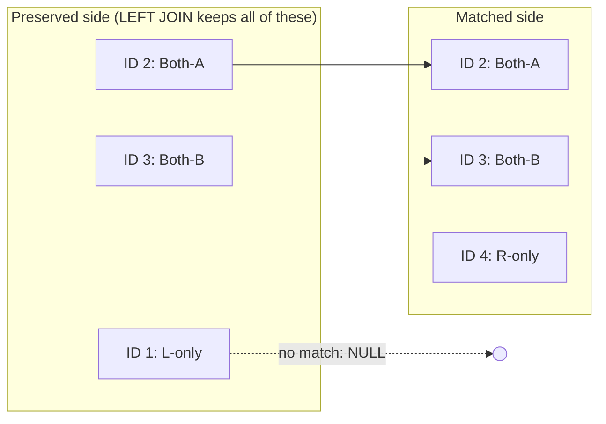

# Lesson 04 — Joins & Set Operations

**Prerequisites:** Lessons 01–03 (SELECT basics, filtering/sorting, data types &
expressions).

A dashboard's revenue-by-product report doubles overnight. Nobody changed the sales
figures — someone added `Sales.SalesOrderDetail` to a query that already joined
`Sales.SalesOrderHeader`, and `SUM(soh.TotalDue)` now runs once per line item instead of
once per order. Joins decide **which rows exist** in your result set before any
aggregate ever runs; get the join wrong and every number downstream is wrong too.

## What you'll learn

- INNER, LEFT, RIGHT, FULL OUTER, and CROSS joins — which rows each keeps
- Multi-table join chains (3+ tables in one query)
- The `ON` vs `WHERE` distinction for outer joins — and how it silently changes join type
- `UNION` vs `UNION ALL`, `INTERSECT`, `EXCEPT` — dedup cost and NULL handling
- Common join mistakes: fan-out double counting, accidental inner joins, unwanted dedup,
  non-SARGable join conditions (e.g. wrapping the joined column in a function) that
  block index seeks — covered in the indexing/performance lessons ahead

## The mental model

A join is **row matching**: pick a side to preserve, walk its rows, and attach whatever
matches on the other side (or `NULL` if nothing matches).



`L1` has no partner on the right, so a `LEFT JOIN` still emits it — with `NULL` in every
right-side column. `R4` never appears at all, because nothing on the preserved (left)
side points to it. Change which side is preserved and you change which unmatched rows
survive.

The second half of the mental model is **fan-out**: a join multiplies rows wherever the
relationship is one-to-many. Order 43672 has 1 header row (`TotalDue = 1791.19`) and 3
detail rows (`ProductID` 711, 712, 714):

```
header (1 row)  JOIN  detail (3 rows)  →  joined result: 3 rows
TotalDue 1791.19 is copied onto ALL THREE — SUM(TotalDue) after the join = 3 × 1791.19.
```

One header row × 3 detail rows = 3 output rows, each carrying a **repeated copy** of the
header column. That repetition is exactly what makes naive aggregation wrong (see
Pitfalls).

## Setup

Run `setup.sql` once. It creates the `lesson04` schema with tiny `[Left]`/`[Right]`
tables (3 rows each: one ID only on the left, one only on the right, two shared) to
demonstrate join types without AdventureWorks-scale noise. `Left`/`Right` are reserved
T-SQL keywords, so every reference — `lesson04.[Left]`, `lesson04.[Right]` — needs
bracket-quoting; forgetting the brackets is a real syntax error, not a style nit.

## Concepts

### 1. Join types — NULL padding on the unmatched side

```sql
SELECT l.ID, l.Value AS LeftVal, r.Value AS RightVal
FROM lesson04.[Left] AS l
LEFT JOIN lesson04.[Right] AS r ON r.ID = l.ID
ORDER BY l.ID;
```

```
ID          LeftVal              RightVal
----------- -------------------- --------------------
          1 L-only               NULL
          2 Both-A               Both-A
          3 Both-B               Both-B
```

Every left row survives; row 1 has no right-side match, so `RightVal` comes back `NULL`
rather than the row being dropped. `INNER JOIN` would show only rows 2–3; `RIGHT JOIN`
would add ID 4 (`R-only`) with `NULL` on the left; `FULL JOIN` shows all four IDs.
`CROSS JOIN` ignores matching entirely and returns every combination (3 × 3 = 9 rows).

**Reach for this when** you need every row from one table regardless of whether related
data exists yet.

### 2. Multi-join chains

Chains just add more `JOIN` clauses — each one matches on its own key, independent of
the others:

```sql
SELECT TOP 5 p.ProductID, p.Name, ps.Name AS Subcategory, pc.Name AS Category
FROM Production.Product p
JOIN Production.ProductSubcategory ps ON ps.ProductSubcategoryID = p.ProductSubcategoryID
JOIN Production.ProductCategory pc ON pc.ProductCategoryID = ps.ProductCategoryID
ORDER BY p.ProductID;
```

```
ProductID   Name                       Subcategory          Category
----------- -------------------------- -------------------- --------------------
        680 HL Road Frame - Black, 58  Road Frames           Components
        706 HL Road Frame - Red, 58    Road Frames           Components
        707 Sport-100 Helmet, Red      Helmets               Accessories
        708 Sport-100 Helmet, Black    Helmets               Accessories
        709 Mountain Bike Socks, M     Socks                 Clothing
```

All three joins here are `INNER`, so a product with no subcategory silently drops out of
the chain. Mixing `INNER` and `LEFT` per table is normal — decide whether "no match"
should drop the row or pad it with `NULL`.

**Reach for this when** the data you need is spread across a foreign-key chain, not one
table.

### 3. `ON` vs `WHERE` in outer joins

A filter on the *outer* (right) table behaves completely differently depending on which
clause it sits in. Same tables, same filter value, only the clause moves:

```sql
-- filter INSIDE ON: still a LEFT JOIN, all products preserved
SELECT COUNT(*) AS RowsKept
FROM Production.Product p
LEFT JOIN Production.ProductSubcategory ps
    ON ps.ProductSubcategoryID = p.ProductSubcategoryID AND ps.Name = 'Mountain Bikes';
```
```
RowsKept
-----------
        504
```

```sql
-- same filter INSIDE WHERE: rows with no Mountain Bikes match get discarded
SELECT COUNT(*) AS RowsKept
FROM Production.Product p
LEFT JOIN Production.ProductSubcategory ps
    ON ps.ProductSubcategoryID = p.ProductSubcategoryID
WHERE ps.Name = 'Mountain Bikes';
```
```
RowsKept
-----------
         32
```

All 504 products vs. 32 — the `WHERE` version silently became an `INNER JOIN`, because
`WHERE` runs *after* the outer join has already padded non-matches with `NULL`, and
`ps.Name = 'Mountain Bikes'` is never true when `ps.Name IS NULL`.

**Reach for this when** you need to narrow the *matched* rows without losing the
unmatched ones — put the condition in `ON`.

### 4. Set operations — dedup cost and NULL handling

`UNION`/`INTERSECT`/`EXCEPT` require the same column count with compatible types; names
come from the first query. `UNION ALL` keeps every row (fast, no sort); `UNION`
deduplicates (sorts internally to compare rows — slower, and it can quietly erase rows
you meant to keep). `INTERSECT` keeps only rows present in both results; `EXCEPT` keeps
rows in the first result that are absent from the second:

```sql
SELECT COUNT(*) AS Rows FROM (
    SELECT Color FROM Production.Product WHERE Color IS NOT NULL
    UNION ALL
    SELECT Color FROM Production.Product WHERE Color IS NOT NULL
) t;   -- UNION ALL of the color column with itself
```
```
Rows
-----------
        512
```

Swap `UNION ALL` for `UNION` on the identical query and the row count collapses from 512
(256 + 256, every row kept) to 9 (only the distinct colors survive) — dedup found and
removed 503 rows.

Set operators also treat `NULL` as matching `NULL` — the opposite of a normal join or
`WHERE`, where `NULL = NULL` is unknown (never true):

```sql
SELECT Color FROM Production.Product WHERE ProductID = 1   -- Color is NULL
INTERSECT
SELECT Color FROM Production.Product WHERE ProductID = 2;  -- Color is also NULL
```
```
Color
---------------
NULL
```

Both products have a `NULL` color and `INTERSECT` reports them as a match — a `JOIN ON
a.Color = b.Color` would never match two `NULL`s this way.

**Reach for this when** you're combining or comparing two result sets and need to
control precisely whether duplicates and `NULL`s count as "the same row."

## Worked examples

`examples.sql` runs these against `lesson04.[Left]`/`[Right]` and AdventureWorks:

1. `INNER JOIN` on `Left`/`Right` — notice only rows 2 and 3 (the shared IDs) appear.
2. `LEFT JOIN` — notice row 1 appears with `NULL` right-side columns.
3. `RIGHT JOIN` — notice row 4 appears with `NULL` left-side columns.
4. `FULL JOIN` — notice all four IDs appear, `NULL`-padded on whichever side is missing.
5. Five-table join (order → customer → person → detail → product) — header columns repeat
   on every detail row (fan-out in action, harmless here since nothing is aggregated).
6. `UNION ALL` vs `UNION` on two orders' product lists — both return 14 rows here since
   these two orders share no products (contrast with Pitfall 3, where they do overlap).
7. `EXCEPT` — products sold but never purchased from a vendor.
8. `INTERSECT` — products both sold and purchased.

## Pitfalls

- **Fan-out double counting.** Joining a one-row header to its many detail rows and then
  aggregating the header column multiplies it by the detail row count:

  ```sql
  SELECT soh.SalesOrderID, SUM(soh.TotalDue) AS WrongTotalDue, COUNT(*) AS LineCount
  FROM Sales.SalesOrderHeader soh
  JOIN Sales.SalesOrderDetail sod ON sod.SalesOrderID = soh.SalesOrderID
  WHERE soh.SalesOrderID = 43659
  GROUP BY soh.SalesOrderID;
  ```
  ```
  SalesOrderID WrongTotalDue         LineCount
  ------------ --------------------- -----------
         43659           277838.8068          12
  ```

  The real `TotalDue` for order 43659 is **23153.2339** — 12× less than the query above.
  Fix: aggregate the header value before joining, not after.

- **`WHERE` on the outer table kills a `LEFT JOIN`.** See Concept 3 above: filtering the
  right-hand table in `WHERE` instead of `ON` drops every row that had no match, turning
  the outer join into an inner join (504 rows → 32 rows in that example) without any
  error or warning.

- **`UNION` drops duplicate rows you wanted to keep.** Orders 43668 and 43692 share 28
  products between their 29 and 28 line items:

  ```sql
  SELECT COUNT(*) AS Rows FROM (
      SELECT ProductID FROM Sales.SalesOrderDetail WHERE SalesOrderID = 43668
      UNION ALL
      SELECT ProductID FROM Sales.SalesOrderDetail WHERE SalesOrderID = 43692
  ) t;
  ```
  ```
  Rows
  -----------
          57
  ```

  Switch `UNION ALL` to `UNION` and the count drops to 29 — the 28 shared products
  collapse to one row each. "How many line items total" silently becomes "how many
  distinct products." Use `UNION ALL` unless duplicates are genuinely meaningless.

- **Self-join without aliasing:** you must alias both copies of the table or SQL Server
  errors, since `ProductID` (etc.) becomes ambiguous.

## Exercises

Open `exercises.sql` and try them in order. Solutions in `exercises-solutions.sql`. The
CHALLENGES section at the bottom is harder: those problems combine this lesson's topic
with earlier lessons and usually need 2+ concepts in one query.

## Cheatsheet link

See `cheatsheets/03-joins-and-sets.md`.
