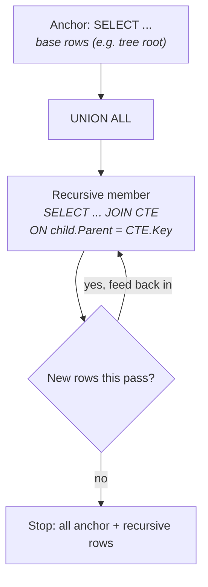

# Lesson 06 — Subqueries & CTEs

**Prerequisites:** Lessons 01–05 (SELECT, filtering, joins, GROUP BY aggregation).

You write a query, get it working, move on. Six months later you (or a teammate) open it
again and it's a wall of nested `SELECT`s three levels deep — which one runs first? What
does the innermost one even return? Subqueries nested inline are unreadable once you stack
more than one; **CTEs let you name each step**, so the query reads top-to-bottom like a
recipe instead of an onion you have to peel from the inside out.

## What you'll learn

- Scalar subqueries in `SELECT` and `WHERE` — and what happens when they return >1 row
- `IN` with a subquery vs `EXISTS` / `NOT EXISTS`, and why `NOT IN` breaks silently on `NULL`
- Correlated subqueries — how to read them inside-out, and their per-row cost
- Non-recursive CTEs: refactoring a nested query into named steps with identical output
- Recursive CTEs for hierarchies and sequences, with `MAXRECURSION`

## The mental model

A recursive CTE is a loop that runs inside the query engine: an **anchor** produces the
starting rows, a **recursive member** joins back to the CTE's own output to produce the
next layer, and the engine keeps re-running the recursive member — feeding it the *previous
pass's new rows* — until a pass produces nothing.



Non-recursive CTEs don't loop — a CTE is just a `SELECT` given a name so a later part of the
query (or another CTE) can `FROM`/`JOIN` it. Think of each as a **named building block**:
lesson 18's whole approach to complex queries is chaining these blocks, one grain-change per
step.

## Setup

Run `setup.sql` once (creates the empty `lesson06` schema). Demos and exercises run entirely
against AdventureWorks' existing tables.

## Concepts

### 1. Scalar subqueries — one value, or an error

A subquery in `SELECT` or a comparison (`WHERE col = (...)`) must collapse to exactly one
row and one column — SQL Server needs a single scalar to plug into the expression:

```sql
SELECT TOP (5) SalesOrderID, TotalDue,
    (SELECT AVG(TotalDue) FROM Sales.SalesOrderHeader) AS AvgOrderValue,
    TotalDue - (SELECT AVG(TotalDue) FROM Sales.SalesOrderHeader) AS DiffFromAvg
FROM Sales.SalesOrderHeader
ORDER BY SalesOrderID;
```

```
SalesOrderID TotalDue              AvgOrderValue         DiffFromAvg
------------ --------------------- --------------------- ---------------------
       43659            23153.2339             3915.9951            19237.2388
       43660             1457.3288             3915.9951            -2458.6663
       43661            36865.8012             3915.9951            32949.8061
       43662            32474.9324             3915.9951            28558.9373
       43663              472.3108             3915.9951            -3443.6843
```

The subquery runs once (no reference to the outer row), so every row gets the same
`AvgOrderValue` — a reference value, not a correlated lookup (that's concept 3). Ask for a
scalar subquery that returns more than one row and SQL Server refuses to guess which:

```sql
SELECT TOP (5) SalesOrderID,
    (SELECT TotalDue FROM Sales.SalesOrderHeader) AS BadScalar
FROM Sales.SalesOrderHeader;
```

```
Msg 512, Level 16, State 1, Server ..., Line 2
Subquery returned more than 1 value. This is not permitted when the subquery follows =,
!=, <, <= , >, >= or when the subquery is used as an expression.
```

**Reach for this when** you need a single reference value (an average, a max, a count)
alongside detail rows.

### 2. `IN` vs `EXISTS` — and the `NOT IN` trap with `NULL`

`IN` materializes the subquery's full result and checks membership; `EXISTS` just asks "is
there at least one matching row?" and stops at the first hit. They usually agree — until the
subquery can return a `NULL`, then `NOT IN` breaks silently. Among Silver-colored products,
`ProductSubcategoryID` is 7 `NULL`s next to 36 real subcategory IDs:

```sql
-- NOT IN: silently returns nothing once the subquery includes a NULL
SELECT COUNT(*) AS NotInCount FROM Production.Product
WHERE ProductSubcategoryID NOT IN
    (SELECT ProductSubcategoryID FROM Production.Product WHERE Color = 'Silver');

-- NOT EXISTS: correct, unaffected by NULLs in the compared set
SELECT COUNT(*) AS NotExistsCount FROM Production.Product AS p
WHERE NOT EXISTS (SELECT 1 FROM Production.Product AS p2
                   WHERE p2.Color = 'Silver' AND p2.ProductSubcategoryID = p.ProductSubcategoryID);
```

```
NotInCount
-----------
          0

NotExistsCount
--------------
        438
```

Out of 504 products, the correct answer is 438 — `NOT IN` gives **0**. Once the subquery's
result contains a `NULL`, every `col <> NULL` comparison in the implied `AND` chain evaluates
to `UNKNOWN`, and `UNKNOWN` can never satisfy `WHERE` — so every row is dropped, silently.

**Reach for this when** you're excluding rows by a subquery's values — always write
`NOT EXISTS`, never `NOT IN`, unless you've proven the subquery column can't be `NULL`.

### 3. Correlated subqueries — read them inside-out

A correlated subquery references a column from the *outer* query, so it re-evaluates once per
outer row. Read it inside-out: fix the outer row's values first, then evaluate the inner
query for that one value:

```sql
SELECT soh.SalesOrderID, soh.CustomerID, soh.TotalDue,
    (SELECT AVG(soh2.TotalDue)
     FROM Sales.SalesOrderHeader AS soh2
     WHERE soh2.CustomerID = soh.CustomerID) AS CustomerAvg
FROM Sales.SalesOrderHeader AS soh
WHERE soh.CustomerID = 11091
ORDER BY soh.SalesOrderID;
```

```
SalesOrderID CustomerID  TotalDue              CustomerAvg
------------ ----------- --------------------- ---------------------
       51925       11091               15.4479               46.9360
       52420       11091               59.6590               46.9360
       54113       11091               64.6094               46.9360
       54391       11091               14.2987               46.9360
       54831       11091               82.3004               46.9360
(28 rows total for this customer; CustomerAvg is constant because it's recomputed
 from all of that customer's own orders on every row)
```

`WHERE soh2.CustomerID = soh.CustomerID` is the correlation. Each of this customer's 28 orders
re-triggers the same inner `AVG` — correct here, but exactly the per-row cost in Pitfalls below.

**Reach for this when** each outer row needs its own independently-scoped calculation.

### 4. Non-recursive CTEs — naming a nested query

A CTE doesn't change what the query computes — it changes whether you can *read* it. Same
question, "products priced well above their subcategory's average," two ways:

```sql
-- BEFORE: nested subquery in FROM — no name to refer back to
SELECT p.ProductID, p.Name, p.ListPrice, sub.AvgPrice
FROM Production.Product AS p
JOIN (SELECT ProductSubcategoryID, AVG(ListPrice) AS AvgPrice
      FROM Production.Product
      WHERE ProductSubcategoryID IS NOT NULL AND ListPrice > 0
      GROUP BY ProductSubcategoryID) AS sub ON sub.ProductSubcategoryID = p.ProductSubcategoryID
WHERE p.ListPrice > sub.AvgPrice * 1.5
ORDER BY p.ListPrice DESC;

-- AFTER: the same derived table, named — reads top to bottom
WITH SubcategoryAvg AS (
    SELECT ProductSubcategoryID, AVG(ListPrice) AS AvgPrice
    FROM Production.Product
    WHERE ProductSubcategoryID IS NOT NULL AND ListPrice > 0
    GROUP BY ProductSubcategoryID
)
SELECT p.ProductID, p.Name, p.ListPrice, sa.AvgPrice
FROM Production.Product AS p
JOIN SubcategoryAvg AS sa ON sa.ProductSubcategoryID = p.ProductSubcategoryID
WHERE p.ListPrice > sa.AvgPrice * 1.5
ORDER BY p.ListPrice DESC;
```

```
ProductID   Name                                               ListPrice             AvgPrice
----------- -------------------------------------------------- --------------------- ---------------------
        749 Road-150 Red, 62                                               3578.2700             1597.4500
        750 Road-150 Red, 44                                               3578.2700             1597.4500
        751 Road-150 Red, 48                                               3578.2700             1597.4500
        752 Road-150 Red, 52                                               3578.2700             1597.4500
        753 Road-150 Red, 56                                               3578.2700             1597.4500
(64 rows total — both versions return exactly this same 64-row result)
```

Nothing about the logic changed — `SubcategoryAvg` is the same derived table, just named so
the outer query (or a chained second CTE) can refer to it instead of re-reading a nested block.

**Reach for this when** a nested subquery is more than one join deep, or you'd otherwise
paste the same derived table twice.

### 5. Recursive CTEs — walking a hierarchy

`HumanResources.Employee` stores the org chart as a `hierarchyid` (`OrganizationNode`); a
row's manager is `OrganizationNode.GetAncestor(1)`. A recursive CTE walks it one level per
pass, carrying a `Depth` counter:

```sql
WITH EmpChain AS (
    SELECT BusinessEntityID, JobTitle, OrganizationNode, 0 AS Depth
    FROM HumanResources.Employee
    WHERE OrganizationNode = hierarchyid::GetRoot()
       OR OrganizationNode.GetLevel() = 1

    UNION ALL

    SELECT e.BusinessEntityID, e.JobTitle, e.OrganizationNode, ec.Depth + 1
    FROM HumanResources.Employee AS e
    JOIN EmpChain AS ec ON e.OrganizationNode.GetAncestor(1) = ec.OrganizationNode
)
SELECT BusinessEntityID, JobTitle, Depth
FROM EmpChain
ORDER BY Depth, BusinessEntityID
OPTION (MAXRECURSION 100);
```

```
BusinessEntityID JobTitle                                           Depth
---------------- -------------------------------------------------- -----------
               2 Vice President of Engineering                                0
              16 Marketing Manager                                            0
              25 Vice President of Production                                 0
             234 Chief Financial Officer                                      0
             263 Information Services Manager                                 0
(289 rows total, depths 0–3)
```

The anchor checks *two* conditions on purpose: in this AdventureWorks2022 restore the actual
CEO row (`BusinessEntityID = 1`) has a **`NULL`** `OrganizationNode`, not the documented
`hierarchyid::GetRoot()`, so `GetAncestor()` can never walk down from it — it's excluded from
this depth-only walk entirely (Challenge 1 works around that). `MAXRECURSION` defaults to 100
passes; this hierarchy only needs 4, but deeper or cyclic data needs `OPTION (MAXRECURSION n)`
stated explicitly — `0` means unlimited, a footgun on bad data.

**Reach for this when** the data is a hierarchy or a sequence and the depth is unknown or
data-driven, not a fixed number of joins.

## Worked examples

`examples.sql` runs these against AdventureWorks:

1. Scalar subquery — every order next to the overall average; notice it's the same value on
   every row.
2. `IN` subquery — products in the Bikes category via a subcategory lookup.
3. Correlated subquery — each customer's order count, computed per row.
4. `EXISTS` — customers who've placed at least one order; short-circuits per row.
5. `NOT EXISTS` — customers who've never ordered; the *safe* mirror of pitfall #1 below.
6. Non-recursive CTE — top spenders isolated in `OrderSummary`, then joined to `Customer`.
7. Recursive CTE — the full employee hierarchy; notice the anchor's `OR` condition matches
   concept 5 above.

## Pitfalls

- **`NOT IN` returns nothing once the subquery yields a `NULL`.** Demonstrated in concept 2
  above: the correct answer is 438 rows; `NOT IN` silently gives 0. There is no error, no
  warning — the query just returns the wrong answer. Always use `NOT EXISTS` instead.

- **A CTE is re-executed every time you reference it — it is not a temp table** (lesson 18's
  Pitfalls: "CTEs are not temp tables. Referencing the same CTE twice executes it twice.").
  A non-deterministic CTE proves it:

  ```sql
  WITH RandomPick AS (
      SELECT TOP (1) ProductID, NEWID() AS RandomTag
      FROM Production.Product
      ORDER BY NEWID()
  )
  SELECT a.RandomTag AS FirstRef, b.RandomTag AS SecondRef,
         a.ProductID AS FirstID, b.ProductID AS SecondID
  FROM RandomPick AS a, RandomPick AS b;
  ```

  ```
  FirstRef                             SecondRef                            FirstID   SecondID
  ------------------------------------ ------------------------------------ --------- ---------
  992C0FE5-741C-4AF9-8763-00134389BCDB B803EE60-C50A-4127-9F6E-0062F43FB253         1       927
  ```

  If `RandomPick` ran once and was reused, `FirstID`/`SecondID` would match. They don't —
  each reference re-ran the CTE independently. Reuse an expensive step via a `#temp` table.

- **A scalar subquery in `SELECT` runs once per outer row — a hidden N+1.** It doesn't
  always look expensive (the optimizer can flatten a simple correlated `MAX`/`COUNT` into a
  join), but a `TOP (1) ... ORDER BY` subquery usually can't be flattened:

  ```sql
  SET STATISTICS IO ON;
  SELECT c.CustomerID,
      (SELECT TOP (1) soh.SalesOrderID
       FROM Sales.SalesOrderHeader AS soh
       WHERE soh.CustomerID = c.CustomerID
       ORDER BY soh.OrderDate DESC) AS LatestOrderID
  FROM Sales.Customer AS c;   -- 19,820 customers
  ```

  ```
  Table 'Worktable'. Scan count 19820, logical reads 103759, ...
  Table 'SalesOrderHeader'. Scan count 1, logical reads 686, ...
  Table 'Customer'. Scan count 1, logical reads 37, ...
  ```

  Scan count **19820** — one execution per customer row. Fix it the same way as concept 4:
  pull the per-row logic into a CTE and `JOIN`/`GROUP BY` it once instead of re-querying.

## Exercises

Open `exercises.sql` and try them in order. Solutions in `exercises-solutions.sql`. The
CHALLENGES section at the bottom is harder: those problems combine this lesson's topic with
earlier lessons and usually need 2+ concepts in one query.

## Cheatsheet link

See `cheatsheets/01-tsql-syntax.md`.
