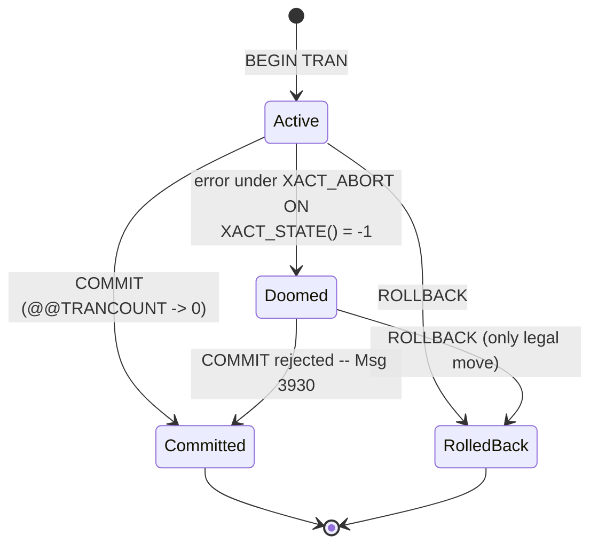

# Lesson 11 — Transactions, Errors & Concurrency

**Prerequisites:** Lessons 01–05 (DML), lesson 09 (variables, control-of-flow),
and lesson 10 (stored procedures — you'll wrap transactions in procs here).

The payment row saved, the ledger insert failed on a constraint, and *nothing
rolled back* — because a T-SQL error does **not** abort the transaction by
default. The half-finished write just sat there, transaction open and holding
locks, until the connection dropped. This lesson covers the three things that keep
multi-statement writes correct: transaction boundaries, error handling that
actually rolls back, and isolation levels that decide what concurrent sessions see.

## What you'll learn

- `BEGIN TRANSACTION` / `COMMIT` / `ROLLBACK` and what `@@TRANCOUNT` really counts
- `TRY / CATCH`, `THROW`, and the `ERROR_*()` functions inside a `CATCH`
- Why `SET XACT_ABORT ON` is the sane default, and the "doomed" transaction state
- The isolation-level ladder — dirty / non-repeatable / phantom reads — and RCSI
- Deadlocks: how they form, who becomes the victim (error 1205), and the two-session demo

## The mental model

A transaction is a tiny state machine. It opens **Active**; `COMMIT` makes every
change durable, `ROLLBACK` discards them all. The trap is the fourth state — an
error inside a transaction does not roll it back on its own. Under `XACT_ABORT ON`
a failed statement drives the transaction to **Doomed** (`XACT_STATE() = -1`):
still open and holding locks, but poisoned — the only legal move is `ROLLBACK`. Try
to `COMMIT` a doomed transaction and you get Msg 3930.



## Setup

Run `setup.sql` once. It creates the `lesson11` schema with an `Account` table
(Alice 1000, Bob 500, Carol 250; a `CHECK (Balance >= 0)` constraint gives every
demo a reliable way to fail) and an empty `OrderStaging` table for the savepoint
challenge. Re-run `setup.sql` to reset balances between attempts.

## Concepts

### 1. Transaction boundaries and what `@@TRANCOUNT` counts

`BEGIN TRAN` opens a transaction, `COMMIT` makes it permanent, `ROLLBACK` undoes
everything since the outermost `BEGIN`. `@@TRANCOUNT` reports the nesting depth —
but nesting is a lie: there is only ever **one** real transaction. A nested
`BEGIN TRAN` just increments the counter; the matching `COMMIT` only decrements
it. Nothing is durable until the count reaches 0.

```sql
PRINT CONCAT('start                : ', @@TRANCOUNT);
BEGIN TRAN;   PRINT CONCAT('after BEGIN TRAN     : ', @@TRANCOUNT);
BEGIN TRAN;   PRINT CONCAT('after nested BEGIN   : ', @@TRANCOUNT);
COMMIT;       PRINT CONCAT('after inner COMMIT   : ', @@TRANCOUNT);
COMMIT;       PRINT CONCAT('after outer COMMIT   : ', @@TRANCOUNT);
```

```
start                : 0
after BEGIN TRAN     : 1
after nested BEGIN   : 2
after inner COMMIT   : 1
after outer COMMIT   : 0
```

The "inner commit" wrote nothing — only the outer `COMMIT` (count 1 → 0) did.
**Reach for this when** you need to know whether a write is actually durable, or
whether a `ROLLBACK` in a `CATCH` will fire (`IF @@TRANCOUNT > 0`).

### 2. TRY / CATCH and re-raising with THROW

Wrap risky work in `BEGIN TRY … END TRY` and recover in `BEGIN CATCH`. The
canonical pattern: roll back if a transaction is still open, then `THROW` (with no
arguments) to re-raise the *original* error to the caller unchanged.

```sql
BEGIN TRY
    BEGIN TRAN;
    UPDATE lesson11.Account SET Balance = Balance - 5000 WHERE AccountID = 1; -- CHECK fails
    COMMIT;
END TRY
BEGIN CATCH
    IF @@TRANCOUNT > 0 ROLLBACK;
    PRINT 'CATCH saw: ' + ERROR_MESSAGE();
    THROW;
END CATCH;
```

```
CATCH saw: The UPDATE statement conflicted with the CHECK constraint "CK_Account_Balance"...
Msg 547, Level 16, State 1, Line 5
The UPDATE statement conflicted with the CHECK constraint "CK_Account_Balance"...
```

`THROW` inside a `CATCH` needs no arguments — it rethrows the current error with its
original number (547). Outside a `CATCH` it needs `number, message, state` with the
number ≥ 50000 (`THROW 50001, 'Custom message.', 1;` — severity is fixed at 16, a
non-fatal user error). **Reach for this when** a procedure must fail loudly and let
its caller decide what to do.

### 3. The ERROR_*() functions

Inside a `CATCH`, the `ERROR_*()` family describes what just went wrong. They only
return values inside the `CATCH` block that caught the error.

```sql
BEGIN TRY
    DECLARE @n INT = CAST('not-a-number' AS INT);
END TRY
BEGIN CATCH
    SELECT ERROR_NUMBER() AS ErrNo, ERROR_SEVERITY() AS Severity,
           ERROR_LINE() AS ErrLine, CAST(ERROR_MESSAGE() AS VARCHAR(60)) AS ErrMessage;
END CATCH;
```

```
ErrNo       Severity    ErrLine     ErrMessage
----------- ----------- ----------- ------------------------------------------------------------
        245          16           4 Conversion failed when converting the varchar value 'not-a-n
```

`ERROR_NUMBER()`, `ERROR_MESSAGE()`, `ERROR_LINE()`, `ERROR_SEVERITY()`, and
`ERROR_STATE()` are your black-box recorder. **Reach for this when** you log
failures or branch on a specific error number (see the deadlock retry challenge).

### 4. `SET XACT_ABORT ON` — the sane default

By default a run-time error terminates only the *statement* and leaves the
transaction open (see Pitfalls). `SET XACT_ABORT ON` changes that: any run-time
error aborts the whole batch and rolls the transaction back automatically.

```sql
SET XACT_ABORT ON;
BEGIN TRAN;
UPDATE lesson11.Account SET Balance = Balance - 5000 WHERE AccountID = 1;  -- CHECK fails
PRINT 'this line never runs';
COMMIT;
GO
PRINT CONCAT('@@TRANCOUNT after aborted batch: ', @@TRANCOUNT);
```

```
Msg 547, Level 16, State 1, Line 5
The UPDATE statement conflicted with the CHECK constraint "CK_Account_Balance"...
@@TRANCOUNT after aborted batch: 0
```

The `PRINT` never ran and the transaction is already rolled back (count 0). Put
`SET XACT_ABORT ON` at the top of every stored procedure that owns a transaction.
**Reach for this when** you want errors to fail safe instead of leaking open
transactions.

### 5. Isolation levels — the anomaly ladder

An isolation level trades concurrency for consistency by choosing which read
anomalies it permits. Set it per session with
`SET TRANSACTION ISOLATION LEVEL <level>;`.

| Level | Dirty reads | Non-repeatable | Phantom | Locking behaviour |
|---|---|---|---|---|
| Read Uncommitted | yes | yes | yes | No shared locks — fastest, least safe |
| **Read Committed** (default) | no | yes | yes | Shared lock released right after the read |
| RCSI | no | yes | yes | Row versioning — readers don't block writers |
| Repeatable Read | no | no | yes | Shared locks held until the transaction ends |
| Serializable | no | no | no | Range locks — safest, highest contention |
| Snapshot | no | no | no | Row versioning — fully non-blocking reads |

**RCSI** (Read Committed Snapshot Isolation) keeps the Read Committed guarantee but
serves readers the last committed *version* instead of blocking them — recommended
for OLTP. Enable it once (needs no active connections):

```sql
ALTER DATABASE AdventureWorks2022 SET READ_COMMITTED_SNAPSHOT ON;
```

This course's container already has RCSI **on**, so a plain Read Committed `SELECT`
against a row another session is updating returns the old value instantly instead
of waiting — the two-session challenge has you observe this directly. **Reach for
this when** blocking, stale reads, or lost updates show up under load.

### 6. Deadlocks — the two-session cycle

A deadlock is a lock cycle: session 1 holds A and wants B, session 2 holds B and
wants A. Neither can proceed, so SQL Server picks a **victim**, kills it with
error 1205, and lets the other finish. Run these in two connections at once:

```sql
-- Session 1                                 -- Session 2
BEGIN TRAN;                                   BEGIN TRAN;
UPDATE lesson11.Account                       UPDATE lesson11.Account
  SET Balance = Balance-1 WHERE AccountID=1;    SET Balance = Balance-1 WHERE AccountID=2;
-- (pause)                                     -- (pause)
UPDATE lesson11.Account                       UPDATE lesson11.Account
  SET Balance = Balance-1 WHERE AccountID=2;    SET Balance = Balance-1 WHERE AccountID=1;
COMMIT;                                        COMMIT;
```

One session gets killed; the observed victim message:

```
Msg 1205, Level 13, State 51
Transaction (Process ID 56) was deadlocked on lock resources with another process
and has been chosen as the deadlock victim. Rerun the transaction.
```

The victim rolls back automatically; the survivor commits. Error 1205 is
*transient* — the fix is to retry (the retry challenge). **Reach for this when** two
writers touch the same rows in different orders — ordering writes consistently
avoids the cycle entirely.

## Worked examples

`examples.sql` runs these against `lesson11.Account`:

1. Basic transfer with `BEGIN` / `COMMIT` — notice both updates land together.
2. `ROLLBACK` on insufficient funds — notice the balance is untouched afterward.
3. `TRY/CATCH` with `THROW` — notice the error propagates after the rollback.
4. `CATCH` error functions — notice `ERROR_LINE()` points at the failing statement.
5. Read Committed two-session block — notice session 2 waits (or, under RCSI, doesn't).
6. Check the RCSI setting on AdventureWorks — notice it reads from `sys.databases`.
7. `sys.dm_exec_sessions` — notice your session's isolation level name.

## Pitfalls

- **An error without `XACT_ABORT ON` leaves the transaction open.** The statement
  fails, the batch keeps going, and `@@TRANCOUNT` is stuck at 1 — locks held until
  you notice:

  ```
  Msg 547, Level 16, State 1, Line 5
  The UPDATE statement conflicted with the CHECK constraint "CK_Account_Balance"...
  The statement has been terminated.
  @@TRANCOUNT after error (no rollback done): 1
  ```
  Fix: `SET XACT_ABORT ON`, or always `IF @@TRANCOUNT > 0 ROLLBACK` in a `CATCH`.

- **A nested `ROLLBACK` undoes everything, not just the inner transaction.**
  `ROLLBACK` always unwinds to the outermost `BEGIN`, dropping `@@TRANCOUNT` to 0:

  ```
  inside nested, @@TRANCOUNT = 2
  after ROLLBACK, @@TRANCOUNT = 0
  AccountID   Balance
  ----------- ----------------
            1          1000.00
            2           500.00
  ```
  Both updates vanished. To undo only part of a transaction you need
  `SAVE TRANSACTION` (savepoints — see the challenges).

- **`RAISERROR` and `THROW` are not interchangeable.** `THROW` (no args) rethrows
  the original error number; `RAISERROR` cannot preserve it and re-raises as 50000:

  ```
  -- THROW;              -> Msg 245  (original conversion error number kept)
  -- RAISERROR(...,16,1) -> Msg 50000 (original number lost)
  ```
  Prefer `THROW` for rethrowing. `THROW` with no arguments is legal *only* inside a
  `CATCH`; elsewhere it needs `number, message, state`. `RCSI` also costs TempDB
  space for row versions — acceptable for most OLTP, but watch TempDB growth.

## Exercises

Open `exercises.sql` and try them in order. Solutions in `exercises-solutions.sql`.
The CHALLENGES section at the bottom is harder: a deadlock-retry procedure, a
doomed-transaction demo, a two-session RCSI observation, and savepoints — each
combines this lesson's ideas with the procedures and control-flow from lessons 09–10.

## Cheatsheet link

See `cheatsheets/01-tsql-syntax.md`.
